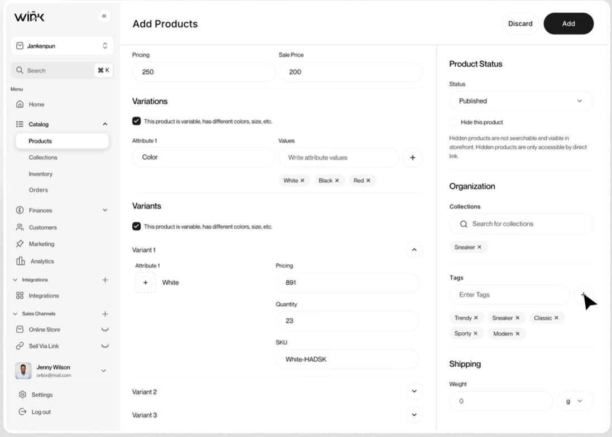

# Design Guideline – Admin Ecommerce Thời trang

> Phiên bản 1.3 · Cập nhật: 25/10/2026 · Thay đổi: thêm Phụ lục A (áp dụng cho nine2fine – Angular, các quyết định đồng bộ design system). **Phụ lục A được ưu tiên hơn mọi mục khác khi mâu thuẫn.**
> Áp dụng cho: Designer, Frontend Dev, PM/BA khi thiết kế và xây dựng trang quản trị.

---

## Mục lục

0. [Giới thiệu](#0-giới-thiệu)
1. [Nguyên tắc cốt lõi](#1-nguyên-tắc-cốt-lõi)
2. [Khung ứng dụng (App shell)](#2-khung-ứng-dụng-app-shell)
3. [Phong cách thị giác (Visual style)](#3-phong-cách-thị-giác-visual-style)
4. [5 kiểu trang chuẩn](#4-5-kiểu-trang-chuẩn)
5. [Thành phần dùng chung](#5-thành-phần-dùng-chung)
6. [Quy tắc theo từng module](#6-quy-tắc-theo-từng-module)
7. [Nội dung và ngôn ngữ](#7-nội-dung-và-ngôn-ngữ)
8. [Trạng thái hệ thống, phân quyền, responsive, accessibility](#8-trạng-thái-hệ-thống-phân-quyền-responsive-accessibility)
9. [Checklist review trước khi bàn giao](#9-checklist-review-trước-khi-bàn-giao)
10. [Nguồn tham khảo](#10-nguồn-tham-khảo)

---

## 0. Giới thiệu

**Mục đích:** để mọi màn hình trong admin trông và hoạt động giống nhau, người vận hành học một lần là dùng được mọi module.

**Nguyên lý nền:** admin không thiết kế theo từng module, mà theo **5 kiểu trang** dùng đi dùng lại (Danh sách, Chi tiết, Form tạo mới, Cài đặt, Dashboard). Mỗi module chỉ là một cách áp dụng các kiểu trang này.

**Nguồn tham chiếu chính** (theo thứ tự ưu tiên khi có mâu thuẫn):

| Nguồn | Dùng cho |
|---|---|
| Shopify Polaris | Chuẩn gốc cho layout, pattern, nội dung. Người dùng VN đã quen qua Shopify/Haravan/Sapo |
| SAP Fiori | Trang chi tiết phức tạp (header có KPI, chia section) |
| Ant Design Pro | Template triển khai nhanh nếu team dùng React |
| Nielsen Norman Group | Nguyên tắc UX cho bảng dữ liệu và dashboard |
| Linear, Vercel Geist, Stripe, shadcn/ui | Diện mạo thị giác: modern, clean, minimal (mục 3) |

**Quy tắc vàng:** chọn một hệ thống làm gốc và không trộn. Khi có trường hợp chưa có trong tài liệu, ưu tiên làm giống pattern đã có trong admin, rồi mới đến Polaris.

**Cách dùng tài liệu:**
- Từ khoá **PHẢI** = bắt buộc, review sẽ trả về nếu vi phạm.
- **NÊN** = mặc định, chỉ khác khi có lý do ghi rõ trong spec.
- **KHÔNG** = cấm.

---

## 1. Nguyên tắc cốt lõi

1. **Hiệu quả hơn đẹp.** Người dùng admin làm việc 8 tiếng/ngày. Mỗi click thừa nhân lên hàng nghìn lần mỗi tháng. Ưu tiên mật độ thông tin, phím tắt, thao tác hàng loạt.
2. **Nhất quán tuyệt đối.** Cùng một hành động (Lưu, Xoá, Lọc, Xuất file) luôn ở cùng một vị trí, cùng tên gọi, cùng hình dạng trên mọi trang.
3. **Trạng thái luôn nhìn thấy được.** Đơn hàng, sản phẩm, phiếu kho đều có trạng thái hiển thị bằng badge ngay ở danh sách và header trang chi tiết.
4. **Việc cần làm lên trước.** Màn hình đầu tiên của mỗi module trả lời câu hỏi "hôm nay tôi cần xử lý gì?" (đơn chờ xác nhận, hàng sắp hết, đổi trả đang mở).
5. **Không mất dữ liệu.** Mọi thay đổi chưa lưu đều được cảnh báo. Mọi hành động không hoàn tác được đều cần xác nhận.
6. **Lịch sử truy vết được.** Mọi đối tượng quan trọng (đơn, khách, phiếu kho) có timeline ghi lại ai làm gì, khi nào.
7. **Chỉ hiện những gì người dùng có quyền.** Không hiện nút rồi báo lỗi "không có quyền" khi bấm.

---

## 2. Khung ứng dụng (App shell)

```
┌──────────────────────────────────────────────────────────────┐
│ TOP BAR: Logo · Tìm kiếm toàn cục (⌘K) · Thông báo · Tài khoản │
├────────────┬─────────────────────────────────────────────────┤
│ SIDEBAR    │ PAGE HEADER: ← Quay lại · Tiêu đề · Badge ·      │
│            │              Hành động phụ · [Hành động chính]   │
│ Tổng quan  ├─────────────────────────────────────────────────┤
│ Đơn hàng   │                                                 │
│ Sản phẩm   │ NỘI DUNG TRANG                                  │
│ Tồn kho    │                                                 │
│ Khách hàng │                                                 │
│ Khuyến mãi │                                                 │
│ Nội dung   │                                                 │
│ Báo cáo    │                                                 │
│ Kênh bán   │                                                 │
│ ────────   │                                                 │
│ Cài đặt    │                                                 │
└────────────┴─────────────────────────────────────────────────┘
```

### 2.1 Sidebar
- **PHẢI** sắp xếp menu theo tần suất sử dụng, không theo bảng chữ cái. Thứ tự chuẩn: Tổng quan → Đơn hàng → Sản phẩm → Tồn kho → Khách hàng → Khuyến mãi → Nội dung → Báo cáo → Kênh bán.
- **PHẢI** đặt Cài đặt ở dưới cùng, tách khỏi các mục vận hành.
- **NÊN** tối đa 2 cấp. Mục con chỉ hiện khi mục cha đang active.
- **NÊN** hiện số đếm cạnh mục cần xử lý (VD: Đơn hàng `12` = 12 đơn chờ xác nhận).
- Sidebar thu gọn được thành dạng chỉ icon trên màn hình < 1280px.

### 2.2 Top bar
- Tìm kiếm toàn cục tìm được: mã đơn, tên/SĐT khách, tên sản phẩm, SKU, barcode. Phím tắt `Ctrl/⌘ + K`.
- Thông báo: đơn mới, tồn thấp, đối soát lệch, yêu cầu đổi trả mới.

### 2.3 Page header
- **PHẢI** có: tiêu đề trang, hành động chính (tối đa 1 nút primary).
- Trang chi tiết **PHẢI** có: nút quay lại danh sách, badge trạng thái cạnh tiêu đề, nút điều hướng bản ghi trước/sau (‹ ›).
- Hành động phụ: tối đa 2 nút hiện trực tiếp, còn lại gom vào menu "Thêm thao tác ▾".
- Hành động nguy hiểm (Xoá, Huỷ đơn) **KHÔNG** đặt ở header; đặt cuối trang hoặc trong menu "Thêm thao tác".

---

## 3. Phong cách thị giác (Visual style)

### 3.1 Định hướng: Modern · Clean · Minimal

**Một câu tóm tắt:** *Yên tĩnh chứ không trống rỗng.* Khung giao diện lùi về sau, dữ liệu và ảnh sản phẩm là trung tâm.

Minimal trong admin **không** có nghĩa là ít thông tin. Admin vẫn dày dữ liệu; minimal là cách **giảm nhiễu thị giác** để dữ liệu đó dễ đọc hơn.

**Mẫu chuẩn (reference)** – mọi màn hình phải trông cùng "họ" với mẫu này:



*File ảnh `reference-style.png` đặt cùng thư mục với tài liệu này. Mẫu chỉ dùng làm chuẩn **diện mạo**; một số điểm UX trong mẫu được sửa lại ở 3.13.*

**Năm đặc điểm nhận diện của mẫu:**

1. **Hoàn toàn đơn sắc.** Trắng, xám, đen. Nút primary đen là điểm nhấn duy nhất trên màn hình.
2. **Không có card.** Vùng nội dung là một mặt phẳng trắng; các nhóm ngăn bằng đường kẻ ngang mảnh và khoảng trắng; hai cột chia bằng một đường kẻ dọc.
3. **Bo tròn hoàn toàn (pill).** Input, select, nút, chip, nút icon đều bo tròn hết.
4. **Sidebar nền xám nhạt**, mục đang chọn là "viên" trắng nổi nhẹ.
5. **Chữ nhẹ.** Tiêu đề dùng độ đậm 500, không dùng chữ đậm nặng.

**Hình mẫu tham khảo thêm** (moodboard ở 3.12):

| Sản phẩm | Học điều gì |
|---|---|
| **Linear** | Không phải phần tử nào cũng nặng như nhau; viền mềm, phân tách tinh tế |
| **Vercel (Geist)** | Hệ màu đơn sắc tương phản cao; typography dẫn dắt bố cục |
| **Stripe Dashboard** | Màu chỉ dùng để mang nghĩa (xanh = thành công, đỏ = thất bại); bảng dữ liệu sạch |
| **Shopify admin (thiết kế mới 2026)** | Chuẩn ngành ecommerce; rollout từ 15/09/2026 |
| **shadcn/ui** | Bộ component nền phổ biến, trung tính, dễ chỉnh sang kiểu pill |

> ⚠️ **Bài học từ Shopify 2023:** khi Shopify ra mắt giao diện admin mới năm 2023, nhiều merchant phàn nàn chữ nhỏ hơn, màu tương phản thấp, gần như đơn sắc, và các chỉ số quan trọng bị giấu đi. **Minimal ≠ chữ nhỏ ≠ màu nhạt ≠ giấu thông tin.** Mọi quyết định "làm gọn" phải qua được bài kiểm tra tương phản (3.3, 8.4) và bài kiểm tra 3 giây của dashboard (4.5).

### 3.2 Mười quy tắc của phong cách

1. **Nền đơn sắc, màu chỉ để mang nghĩa.** Mục tiêu trên một màn hình: ~95% trắng/xám/đen, ~5% màu trạng thái. Không có màu trang trí.
2. **Mặt phẳng, không card.** Nội dung đặt trực tiếp trên nền trắng. Phân nhóm bằng khoảng trắng trước, đường kẻ 1px sau. Bóng đổ chỉ cho lớp nổi.
3. **Phân cấp bằng chữ, không bằng khung.** Dùng cỡ chữ và 3 mức xám (primary / secondary / tertiary) thay vì nền màu, khung viền hay icon trang trí.
4. **Một điểm nhấn mỗi vùng.** Mỗi trang/modal chỉ có 1 nút đen (primary).
5. **Bo tròn hoàn toàn cho phần tử tương tác một dòng** (input, select, nút, chip, badge, nút icon). Phần tử nhiều dòng hoặc khung lớn (textarea, dropdown menu, modal, ảnh) dùng bo 12–16px. Không trộn hai kiểu cho cùng một loại phần tử.
6. **Viền mảnh, nhưng ô nhập phải nhìn thấy được.** Đường kẻ phân cách rất nhạt; riêng viền input dùng token riêng đủ tương phản (3.3).
7. **Chữ nhẹ.** Độ đậm 400 và 500. Chỉ số KPI lớn mới dùng 600.
8. **Hiện dần (progressive disclosure).** Hành động phụ trên dòng bảng chỉ hiện khi hover; tuỳ chọn ít dùng gom vào menu "⋯".
9. **Ảnh sản phẩm là màu sắc của trang.** Với thời trang, UI càng trung tính thì ảnh càng nổi bật. Không đặt ảnh lên nền có màu.
10. **Thoáng ở form, gọn ở bảng.** Form dùng input cao 44px; bảng dữ liệu giữ dòng 44px và nút 32px để không mất mật độ.

### 3.3 Màu sắc

Toàn bộ màu khai báo bằng **design token (CSS variables)**, có giá trị cho Light và Dark. **KHÔNG** hard-code mã màu trong component.

**Thang trung tính (nền tảng của cả giao diện):**

| Token | Light | Dark | Dùng cho |
|---|---|---|---|
| `--bg` | `#FFFFFF` | `#09090B` | Nền vùng nội dung chính |
| `--sidebar` | `#F4F4F5` | `#18181B` | Nền sidebar |
| `--surface-raised` | `#FFFFFF` | `#27272A` | Mục sidebar đang chọn, dropdown, modal |
| `--muted` | `#F4F4F5` | `#27272A` | Nền chip, hover dòng bảng, hover menu, ô tìm kiếm |
| `--divider` | `#E4E4E7` | `#27272A` | Đường kẻ phân cách section, dòng bảng, cột |
| `--border-input` | `#8E8E96` | `#71717A` | **Viền input, select, nút secondary** |
| `--text-primary` | `#18181B` | `#FAFAFA` | Tiêu đề, nội dung chính, giá trị đã nhập |
| `--text-secondary` | `#52525B` | `#A1A1AA` | Nhãn trường, header bảng, mô tả |
| `--text-tertiary` | `#71717A` | `#A1A1AA` | Placeholder, chú thích, timestamp |
| `--text-disabled` | `#A1A1AA` | `#52525B` | Trạng thái vô hiệu (không dùng cho chữ cần đọc) |

> **Về viền input:** mẫu tham chiếu dùng viền rất nhạt (khoảng `#E4E4E7`, tương phản ~1.3:1 với nền trắng). WCAG 2.1 (tiêu chí 1.4.11) yêu cầu ranh giới của ô nhập đạt tối thiểu **3:1**. `#8E8E96` đạt ~3.2:1 trên nền trắng. Nếu team chọn giữ viền nhạt như mẫu vì thẩm mỹ, phải ghi nhận đây là ngoại lệ không đạt chuẩn tiếp cận và bù bằng nhãn luôn hiển thị phía trên ô.

**Màu nhấn (accent):**

| Token | Light | Dark | Dùng cho |
|---|---|---|---|
| `--primary` | `#18181B` | `#FAFAFA` | Nút primary, checkbox đã chọn, toggle bật |
| `--primary-foreground` | `#FFFFFF` | `#18181B` | Chữ trên nút primary |
| `--focus` | `#18181B` | `#FAFAFA` | Vòng focus (đen, giữ tính đơn sắc) |
| `--link` | `#18181B` + gạch chân | `#FAFAFA` + gạch chân | Link trong văn bản |

> Phong cách này **không có màu thương hiệu trong UI**. Màu thương hiệu (nếu có) chỉ xuất hiện ở logo. Biểu đồ dùng đen/xám (xem 3.10).

**Màu trạng thái (semantic)** – dùng cho badge, banner, chữ lỗi. Đây là nơi duy nhất có màu.

| Tone | Ý nghĩa | Nền (Light) | Chữ (Light) | Ví dụ |
|---|---|---|---|---|
| Neutral | Chưa bắt đầu, nháp, lưu trữ | `#F4F4F5` | `#3F3F46` | Nháp, Chưa xử lý |
| Info | Đang xử lý, đang diễn ra | `#EFF6FF` | `#1D4ED8` | Đang giao, Đang đóng gói |
| Success | Hoàn tất, tích cực | `#F0FDF4` | `#15803D` | Đã thanh toán, Giao thành công |
| Warning | Cần chú ý, chưa xong | `#FFFBEB` | `#B45309` | Chờ thanh toán, Sắp hết hàng |
| Critical | Lỗi, thất bại, cần xử lý gấp | `#FEF2F2` | `#B91C1C` | Giao thất bại, Hết hàng, Lệch đối soát |

- **KHÔNG** truyền tải ý nghĩa chỉ bằng màu. Badge luôn có chữ.
- Màu đỏ chỉ xuất hiện khi thật sự có vấn đề. Một màn hình bình thường **không** có màu đỏ.

### 3.4 Typography

- **Font:** `Inter` (mặc định) hoặc `Be Vietnam Pro`. Cả hai hỗ trợ đầy đủ dấu tiếng Việt. Nếu muốn dùng font khác (VD: Geist), **PHẢI** kiểm tra hiển thị tiếng Việt có dấu trước khi chọn.
- **Độ đậm:** 400 (nội dung) và 500 (tiêu đề, nhãn, nút). 600 **chỉ** dùng cho số KPI. **KHÔNG** dùng 700+.
- **Thang cỡ chữ:**

| Token | Size / Line-height | Weight | Dùng cho |
|---|---|---|---|
| `text-xs` | 12 / 16 | 400–500 | Chú thích, badge, chip, nhãn nhóm menu |
| `text-sm` | 13 / 20 | 400–500 | Nhãn trường form, header bảng, helper text |
| `text-base` | 14 / 20 | 400 | **Nội dung mặc định**, giá trị trong input, ô bảng, mục menu |
| `text-md` | 16 / 24 | 500 | Tiêu đề section (VD: "Variants", "Organization") |
| `text-lg` | 20 / 28 | 500 | Tiêu đề trang (VD: "Thêm sản phẩm") |
| `text-xl` | 24 / 32 | 600 | Số KPI |
| `text-2xl` | 30 / 36 | 600 | Số KPI chính trên Tổng quan |

- Cỡ chữ tối thiểu cho chữ cần đọc: **12px**. Nội dung chính không nhỏ hơn 14px.
- Tiêu đề ≥ 20px dùng `letter-spacing: -0.01em`.
- Số trong bảng, KPI, giá tiền **PHẢI** dùng `font-variant-numeric: tabular-nums`.
- Mã đơn, SKU, mã vận đơn: font monospace 13px (`JetBrains Mono`, `Geist Mono` hoặc `ui-monospace`).
- **KHÔNG** viết hoa toàn bộ (ALL CAPS) cho tiêu đề hay nút.

### 3.5 Khoảng cách và bố cục

- Bước spacing: **4px**. Thang: 4, 8, 12, 16, 20, 24, 32, 40, 48, 64.
- **Page header** cố định trên cùng vùng nội dung: tiêu đề trang bên trái, nút hành động bên phải; ngăn với nội dung bằng 1 đường kẻ ngang. Cao 72–80px.
- **Trang chi tiết / form – bố cục hai cột phẳng:**
  - Cột chính (trái, ~2/3) và cột phụ (phải, ~1/3) chia bằng **một đường kẻ dọc** `--divider`, không dùng card.
  - Padding mỗi cột: 24–32px.
  - Mỗi nhóm nội dung là một **section**: tiêu đề `text-md` → các trường → khoảng trắng 24px → đường kẻ ngang → section tiếp theo.
- **Trong section:** khoảng cách giữa các trường 16px theo chiều dọc, 12–16px theo chiều ngang (2 trường cùng hàng); nhãn cách input 8px.
- Độ rộng nội dung:
  - Trang danh sách, báo cáo: full-width (tối đa 1600px).
  - Trang chi tiết, form, cài đặt: tối đa 1120px.
- Căn trái mọi thứ theo một đường lưới duy nhất.

### 3.6 Bề mặt, đường kẻ, bo góc, bóng đổ

**Phân lớp bề mặt:** sidebar `--sidebar` (xám nhạt) | vùng nội dung `--bg` (trắng, phẳng) → lớp nổi (dropdown, popover, modal) `--surface-raised` có bóng.

**Bo góc:**

| Token | Giá trị | Dùng cho |
|---|---|---|
| `radius-full` | 9999px | **Input, select, nút (mọi loại), chip, badge, nút icon tròn, ô tìm kiếm, toggle, avatar** |
| `radius-sm` | 4px | Checkbox |
| `radius-md` | 10px | Mục menu sidebar, thumbnail ảnh sản phẩm, ô upload ảnh |
| `radius-lg` | 16px | Textarea, dropdown menu, popover, toast, khung vùng nội dung chính (nếu tách khỏi sidebar) |
| `radius-xl` | 20px | Modal, panel trượt |

**Bóng đổ:**

| Token | Giá trị | Dùng cho |
|---|---|---|
| `shadow-none` | none | Mặc định cho mọi thứ trên mặt phẳng |
| `shadow-xs` | `0 1px 2px rgba(0,0,0,0.06)` | Mục sidebar đang chọn |
| `shadow-md` | `0 8px 24px rgba(0,0,0,0.08)` | Dropdown, popover, toast |
| `shadow-lg` | `0 24px 48px rgba(0,0,0,0.12)` | Modal, panel trượt |

- Dark mode: bỏ bóng; phân lớp bằng màu `--surface-raised` sáng hơn nền.
- Overlay sau modal: `rgba(0,0,0,0.4)`, không blur.

### 3.7 Icon

- Bộ icon: **Lucide** (nét outline). Chỉ dùng một bộ.
- Nét 1.5px; kích thước 16px (trong input, bảng, chip) hoặc 18–20px (menu, header).
- Màu icon mặc định `--text-secondary`; khi active `--text-primary`. **KHÔNG** tô màu khác nhau cho từng icon.
- Icon đứng một mình **PHẢI** có tooltip và `aria-label`.

### 3.8 Chuyển động (Motion)

| Loại | Thời lượng | Easing |
|---|---|---|
| Hover, đổi màu, focus | 120ms | ease-out |
| Mở dropdown, popover, tooltip | 150ms | ease-out (fade + dịch 4px) |
| Mở/thu section, accordion | 200ms | ease-out |
| Mở modal, panel trượt | 200ms | ease-out |
| Đóng bất cứ thứ gì | 120–150ms | ease-in |

- **KHÔNG** dùng bounce, spring, xoay, parallax hay hiệu ứng trang trí.
- Tôn trọng `prefers-reduced-motion`.

### 3.9 Mật độ (density)

| Ngữ cảnh | Chiều cao | Ghi chú |
|---|---|---|
| Input, select trong form | 44px | Thoáng như mẫu |
| Input, select trong thanh lọc / toolbar | 36px | |
| Nút ở page header | 44px | |
| Nút mặc định trong nội dung | 36px | |
| Nút trong bảng, chip lọc | 32px | |
| Dòng bảng | 44px | Tuỳ chọn Gọn 36px / Thoáng 52px, ghi nhớ theo người dùng |
| Mục menu sidebar | 36px | |

### 3.10 Diện mạo từng thành phần

> **Quy ước:** từ "card" trong mục 4–6 của tài liệu này được hiểu là **section phẳng** (tiêu đề + nội dung + đường kẻ ngăn cách), không phải khung có viền.

**Sidebar**
- Nền `--sidebar`, rộng 240–260px, không viền, không bóng.
- Trên cùng: logo + nút thu gọn sidebar. Tiếp theo: bộ chọn cửa hàng/chi nhánh (pill trắng, có icon ⇅) và ô tìm kiếm (pill `--muted` đậm hơn nền một chút, gợi ý phím `⌘K` bên phải).
- Nhãn nhóm ("Menu", "Kênh bán"…): 12px `--text-tertiary`.
- Mục menu: icon 18px + chữ 14px `--text-secondary`. Mục đang chọn: nền `--surface-raised` (trắng), `shadow-xs`, bo `radius-md`, chữ `--text-primary` weight 500.
- Menu con thụt vào ngang với chữ của mục cha, không có icon.
- Dưới cùng: thẻ người dùng (avatar + tên + email), Cài đặt, Đăng xuất.

**Nút**

| Loại | Diện mạo |
|---|---|
| Primary | Pill, nền `--primary` (đen), chữ trắng weight 500, không viền |
| Secondary | Pill, nền trắng, viền 1px `--border-input`, chữ `--text-primary` |
| Ghost | Pill, không nền, không viền; hover nền `--muted`. Dùng trong toolbar, hành động trên dòng |
| Icon | Hình tròn, viền 1px `--border-input` hoặc ghost, icon 16–18px ở giữa (VD: nút "+" thêm giá trị) |
| Destructive | Pill, nền `#B91C1C`, chữ trắng – chỉ trong modal xác nhận |

- Padding ngang: 20px (44px), 16px (36px), 12px (32px).
- Focus: vòng 2px `--focus`, cách viền 2px.
- Page header: Secondary bên trái, Primary bên phải (VD: [Huỷ] [Lưu sản phẩm]).

**Input và Select**
- Pill, cao 44px (form), nền trắng, viền 1px `--border-input`, padding ngang 16–20px.
- Nhãn 13px `--text-secondary` **luôn** nằm phía trên ô, cách 8px. Không dùng floating label, không dùng placeholder thay nhãn.
- Placeholder `--text-tertiary`; giá trị đã nhập `--text-primary`.
- Hover: viền `--text-tertiary`. Focus: viền `--primary` + vòng focus. Lỗi: viền và chữ lỗi `#B91C1C` bên dưới ô.
- Select: chevron ▾ 16px bên phải. Ô tìm kiếm: icon kính lúp bên trái.
- Input tiền/đơn vị: hậu tố bên trong ô, màu `--text-tertiary` (VD: `250.000` `đ`; `500` `g`). Đơn vị có thể đổi → select pill nhỏ đặt sát bên phải (như ô Weight + "g ▾" trong mẫu).
- Textarea (mô tả sản phẩm): bo `radius-lg` 16px, không pill.

**Chip (tag, giá trị thuộc tính, bộ lọc đang áp dụng)**
- Pill, nền `--muted`, chữ 12–13px `--text-primary`, cao 28px, nút ✕ 12px bên phải.
- Không viền, không màu.

**Checkbox, Radio, Toggle**
- Checkbox 16px, bo 4px, viền `--border-input`; khi chọn nền `--primary` + dấu ✓ trắng.
- Toggle: pill, nền `--primary` khi bật, `--divider` đậm khi tắt.
- Nhãn 14px bên phải, cách 8px; mô tả phụ (nếu có) 12–13px `--text-tertiary` bên dưới.

**Section (thay cho card)**
- Tiêu đề 16px weight 500, cách nội dung 16px.
- Hành động của section (Sửa, Xem tất cả, Thêm) là nút ghost hoặc link ở góc phải tiêu đề.
- Section có thể thu gọn: nút icon tròn ⌃/⌄ ở góc phải.
- Kết thúc section bằng khoảng trắng 24px + đường kẻ `--divider`. Section cuối không có đường kẻ.
- **KHÔNG** lồng section có viền trong section.

**Bảng dữ liệu**
- Đặt trực tiếp trên nền trắng, không khung bao.
- Header: chữ 13px weight 500 `--text-secondary`, đường kẻ dưới `--divider`.
- Dòng: kẻ ngang 1px `--divider`. **KHÔNG** kẻ dọc, **KHÔNG** zebra.
- Hover dòng: nền `--muted`. Dòng đang chọn: nền `--muted` + checkbox đen.
- Hành động trên dòng chỉ hiện khi hover (trên mobile luôn hiện).
- Thumbnail sản phẩm: 40×40px, bo `radius-md`, `object-fit: cover`, nền `--muted` cho ảnh trong suốt.

**Badge**
- Pill, cao 22px, chữ 12px weight 500, nền nhạt + chữ đậm cùng tone (bảng 3.3).
- Tuỳ chọn chấm tròn 6px phía trước chữ.
- **KHÔNG** dùng badge nền đặc màu đậm.

**Upload ảnh**
- Ô vuông bo `radius-md`, viền nét đứt 1px `--border-input`, icon "+" ở giữa. Ảnh đã tải hiển thị cùng kích thước, kéo thả để sắp xếp.

**Thẻ KPI**
- Không khung: nhãn 13px `--text-secondary` → số 24–30px weight 600 tabular-nums → dòng so sánh 12–13px (▲▼ màu success/critical). Các KPI đặt cạnh nhau, ngăn bằng đường kẻ dọc `--divider`.

**Biểu đồ**
- Chuỗi chính màu `--text-primary` (đen); kỳ so sánh màu `#D4D4D8`, nét đứt.
- Nhiều chuỗi cần phân biệt: dùng các sắc xám (đen, `#71717A`, `#D4D4D8`). Chỉ dùng màu semantic khi màu mang nghĩa (VD: hoàn thành/thất bại).
- Lưới ngang rất nhạt `--divider` hoặc bỏ; không lưới dọc, không 3D, không gradient.
- Tooltip: nền trắng, bo `radius-lg`, `shadow-md`.

**Empty state**
- Icon 20–24px trong vòng tròn `--muted` + tiêu đề 16px + mô tả 14px `--text-secondary` + nút. Không minh hoạ nhiều màu.

**Toast**
- Nền `--primary` (đen), chữ trắng 14px, bo `radius-lg`, `shadow-md`, góc dưới phải. Toast lỗi: icon đỏ nhỏ bên trái.

**Modal**
- Nền trắng, bo `radius-xl`, padding 24px, `shadow-lg`. Tiêu đề 18px weight 500; nút ở góc dưới phải theo thứ tự [Huỷ] [Hành động chính].

### 3.11 Những điều KHÔNG làm (anti-patterns)

| Không làm | Thay bằng |
|---|---|
| Card có viền/bóng bao từng nhóm nội dung | Section phẳng + đường kẻ ngang |
| Trộn nút bo vuông và nút pill | Mọi nút đều pill |
| Nền gradient, glassmorphism, blur | Nền trắng/xám phẳng |
| Màu thương hiệu trên nút, menu, link | Đen/trắng; màu thương hiệu chỉ ở logo |
| Icon menu mỗi cái một màu | Icon xám đồng nhất |
| Badge nền đặc màu đậm | Badge subtle (nền nhạt, chữ đậm) |
| Viền input mờ đến mức không thấy ô | Token `--border-input` (≥ 3:1) |
| Placeholder thay cho nhãn | Nhãn luôn hiển thị phía trên |
| Chữ < 12px, nội dung chính < 14px | Theo thang 3.4 |
| Chữ đậm 700 cho tiêu đề | Weight 500 |
| Input 44px trong toolbar và bảng | 32–36px theo bảng 3.9 |
| Kẻ dọc và zebra trong bảng | Chỉ kẻ ngang 1px |
| Emoji, minh hoạ hoạt hình | Icon nét mảnh |
| Animation bounce, xoay, chạy chữ | Fade/dịch nhẹ 120–200ms |
| Ẩn chỉ số quan trọng để "trông gọn" | Giữ thông tin, giảm trang trí |

### 3.12 Stack gợi ý và moodboard

**Stack triển khai gợi ý:** React (Next.js) + Tailwind CSS + **shadcn/ui** (Radix UI) + **Lucide** icons + Recharts + TanStack Table. shadcn/ui mặc định bo góc vừa và dùng card; team cần chỉnh lại theo token ở 3.3–3.6 (pill, bỏ card) một lần ở tầng component, không chỉnh từng màn hình.

> **Phân tách hai lớp:** *pattern* (bố cục trang, luồng thao tác – mục 4, 5, 6) theo Shopify Polaris; *diện mạo* (màu, chữ, bề mặt – mục 3) theo mẫu chuẩn ở 3.1. Hai lớp này không mâu thuẫn và không được trộn nguồn trong cùng một lớp.

**Moodboard** – team mở các link sau để xem hình ảnh tham khảo:

| Tham khảo | Xem gì |
|---|---|
| `reference-style.png` (mẫu chuẩn) | Diện mạo tổng thể – ưu tiên cao nhất |
| [Linear – How we redesigned the Linear UI](https://linear.app/blog/how-we-redesigned-the-linear-ui) | Sidebar, header, cách giảm nhiễu thị giác |
| [Linear – Behind the latest design refresh](https://linear.app/blog/behind-the-latest-design-refresh) | Viền mềm, phân cấp trọng lượng thị giác |
| [Vercel – Geist Design System](https://vercel.com/geist) | Hệ màu đơn sắc, typography |
| [10 Best SaaS Dashboard Design Examples (AdminLTE)](https://adminlte.io/blog/saas-dashboard-design-examples/) | Ảnh chụp dashboard Linear, Stripe, Vercel, Attio, Mercury… |
| [35 SaaS Dashboard Design Examples (925 Studios)](https://925studios.co/blog/saas-dashboard-design-examples-2026) | 6 kiểu dashboard, cách dùng màu tối thiểu |
| [7 SaaS UI Design Trends 2026 (SaaSUI)](https://saasui.design/blog/7-saas-ui-design-trends-2026) | Khoảng trắng như công cụ, calm design |

**Bài kiểm tra nhanh "đủ minimal chưa":** đặt màn hình mới cạnh `reference-style.png`. Nếu nhìn như cùng một sản phẩm, và khi chuyển sang thang xám vẫn đọc được phân cấp (tiêu đề, hành động chính, trạng thái cần chú ý) thì đạt.

### 3.13 Áp dụng mẫu chuẩn cho trang Thêm/Sửa sản phẩm

Mẫu tham chiếu là trang "Add Products". Khi làm trang này, giữ nguyên diện mạo nhưng **PHẢI** sửa các điểm UX sau:

| Trong mẫu | Quy định |
|---|---|
| Mỗi biến thể là một accordion (Variant 1, 2, 3…) phải mở từng cái | Dùng **bảng biến thể nhóm theo Màu**, sửa giá/tồn/SKU trực tiếp trong ô (mục 6.3). Áo 3 màu × 5 size = 15 biến thể phải sửa được trên một màn hình |
| Checkbox "This product is variable…" lặp ở cả Variations và Variants | Chỉ một lựa chọn duy nhất ở đầu section Biến thể: "Sản phẩm có nhiều màu/size" |
| Ô giá không có đơn vị, giá sale không thể hiện mức giảm | Hậu tố "đ" trong ô; dưới ô giá sale hiện "Giảm 20%" (12px `--text-tertiary`) |
| Nút "Add" | "Lưu sản phẩm" (tạo mới). Màn sửa dùng save bar, chỉ hiện khi có thay đổi |
| Tag thêm bằng nút "+" riêng | Gõ rồi nhấn Enter hoặc dấu phẩy để tạo chip; nút "+" là tuỳ chọn |
| Viền input rất nhạt | Dùng `--border-input` (3.3) |
| Không có trường ảnh sản phẩm ở phần đầu | Section đầu tiên của cột chính: Tên, Mô tả, **Hình ảnh** (6.2) |
| Trạng thái "Published" + checkbox "Hide this product" tách rời | Một select duy nhất: Đang bán / Nháp / Ẩn / Lên lịch mở bán; mô tả tác động hiện ngay dưới select |

---

## 4. 5 kiểu trang chuẩn

### 4.1 Trang danh sách (Index page)

**Dùng cho:** Đơn hàng, Sản phẩm, Khách hàng, Tồn kho, Mã giảm giá, Phiếu nhập, Đổi trả…

**Cấu trúc (từ trên xuống):**
```
[Page header: Tiêu đề · Xuất file · Nhập file · (+ Tạo mới)]
[Tabs saved views: Tất cả | Chờ xác nhận | Chờ lấy hàng | Đang giao | ... | + ]
[Thanh tìm kiếm · Bộ lọc · Sắp xếp · Chọn cột]
[Chip bộ lọc đang áp dụng ✕]
[Bảng dữ liệu]
[Phân trang · Số dòng/trang]
```

**Bảng dữ liệu phải hỗ trợ 4 việc** (theo NN/g): tìm bản ghi theo tiêu chí, so sánh dữ liệu, xem/sửa một dòng, thao tác trên nhiều bản ghi.

**Quy tắc:**
- **PHẢI** có tabs saved views ở trên bảng. Tab đầu tiên luôn là "Tất cả" và không xoá được. Người dùng có thể lưu bộ lọc hiện tại thành tab mới.
- **PHẢI** lưu trạng thái lọc/sắp xếp/trang vào URL để chia sẻ link và quay lại đúng vị trí.
- **PHẢI** xếp cột theo mức độ quan trọng; cột định danh (mã đơn, tên sản phẩm) luôn đầu tiên và cố định khi cuộn ngang.
- **PHẢI** căn phải các cột số và tiền; căn trái cột chữ.
- **PHẢI** có checkbox đầu dòng → khi chọn ≥ 1 dòng, thanh bulk action hiện ra thay cho thanh lọc, kèm số dòng đã chọn và lựa chọn "Chọn tất cả N kết quả".
- Bấm vào dòng → mở trang chi tiết. Hành động nhanh trên một dòng (sửa nhanh tồn kho, in) dùng **panel trượt bên phải**, **KHÔNG** dùng modal che bảng.
- **NÊN** cho phép ẩn/hiện và sắp xếp lại cột; ghi nhớ theo từng người dùng.
- Phân trang mặc định 50 dòng, tuỳ chọn 20 / 50 / 100.
- Danh sách rỗng: dùng empty state (xem 5.7), phân biệt "chưa có dữ liệu" và "không có kết quả cho bộ lọc này".

### 4.2 Trang chi tiết (Detail page)

**Dùng cho:** chi tiết Sản phẩm, Đơn hàng, Khách hàng, Mã giảm giá, Phiếu kho.

**Layout chuẩn 2/3 + 1/3:**
```
┌─────────────────────────────────────────────────────────┐
│ ← #DH10245  [Đã thanh toán] [Chưa giao]   In · ▾ [Giao hàng] │
├───────────────────────────────────┬─────────────────────┤
│ CỘT CHÍNH (2/3)                   │ CỘT PHỤ (1/3)        │
│ Thông tin định nghĩa đối tượng    │ Trạng thái, metadata │
│ - Card: Sản phẩm trong đơn        │ - Card: Ghi chú      │
│ - Card: Thanh toán                │ - Card: Khách hàng   │
│ - Card: Timeline                  │ - Card: Tag          │
└───────────────────────────────────┴─────────────────────┘
```

**Quy tắc:**
- **PHẢI** đặt thông tin định nghĩa đối tượng ở cột chính; trạng thái, metadata, tóm tắt ở cột phụ.
- **PHẢI** sắp card theo mức độ quan trọng từ trên xuống.
- **PHẢI** dùng chung layout cho Tạo mới và Chỉnh sửa (người dùng học một lần).
- Header **NÊN** có hàng KPI ngắn với đối tượng có số liệu (VD: Khách hàng: Tổng chi tiêu · Số đơn · Lần mua gần nhất).
- Nội dung quá dài (> 6 card) → chia **tab** (VD: Sản phẩm: Thông tin | Biến thể | SEO | Lịch sử).
- Màn hình < 1024px: cột phụ xuống dưới cột chính.

**Mô hình lưu (chọn 1 cho mỗi trang, không trộn):**
- **Save bar theo ngữ cảnh** (mặc định cho form chỉnh sửa): khi có thay đổi, thanh trên cùng hiện "Thay đổi chưa lưu" + [Huỷ] [Lưu]. Lưu toàn bộ trang một lần.
- **Sửa từng phần qua modal** (cho trang chủ yếu để xem, như Đơn hàng): mỗi card có nút "Sửa", mở modal, lưu riêng phần đó.

### 4.3 Trang Form tạo mới (Create / Wizard)
- Đối tượng đơn giản → dùng chính layout trang chi tiết (4.2) ở trạng thái rỗng.
- Quy trình nhiều bước có thứ tự bắt buộc (Tạo phiếu đổi trả, Nhập kho từ PO) → **wizard**: thanh bước trên cùng, nút Quay lại / Tiếp tục ở dưới, bước cuối là trang xác nhận.
- **PHẢI** nhóm trường liên quan vào cùng một card có tiêu đề.
- **PHẢI** validate inline ngay khi rời trường (on blur), không đợi bấm Lưu.
- Trường bắt buộc đánh dấu `*`; nếu đa số trường bắt buộc thì đánh dấu "(không bắt buộc)" cho số ít còn lại.
- Sau khi tạo thành công: chuyển về trang chi tiết của đối tượng vừa tạo + toast "Đã tạo sản phẩm". Chỉ dùng trang kết quả riêng cho quy trình lớn (VD: Nhập 500 sản phẩm từ Excel).

### 4.4 Trang Cài đặt (Settings)
- Trang chỉ mục: lưới các nhóm cài đặt (Thông tin cửa hàng, Thanh toán, Vận chuyển, Thuế & hoá đơn, Thông báo, Nhân viên & phân quyền, Kênh bán…).
- Trong mỗi nhóm dùng **annotated layout**:
```
┌──────────────────────┬────────────────────────────────┐
│ Phí vận chuyển       │ ┌────────────────────────────┐ │
│ Mô tả ngắn giải thích │ │ Card chứa các trường cài đặt │ │
│ phần này làm gì       │ └────────────────────────────┘ │
├──────────────────────┼────────────────────────────────┤
│ Miễn phí vận chuyển   │ ┌────────────────────────────┐ │
│ ...                  │ │ ...                        │ │
└──────────────────────┴────────────────────────────────┘
```
- Mô tả bên trái không lặp lại tiêu đề; giải thích tác động của cài đặt.
- **KHÔNG** dùng annotated layout cho nội dung không chỉnh sửa được.

### 4.5 Dashboard
Phân biệt rõ 2 loại:

| | Dashboard vận hành (Tổng quan) | Dashboard phân tích (Báo cáo) |
|---|---|---|
| Câu hỏi | Hôm nay cần làm gì? | Tại sao số liệu thay đổi? |
| Cập nhật | Gần real-time | Theo khoảng ngày chọn |
| Nội dung | KPI hôm nay + danh sách việc cần làm | Biểu đồ xu hướng, so sánh kỳ, bảng chi tiết |

**Quy tắc:**
- **PHẢI** đặt số quan trọng nhất ở góc trên trái, cỡ chữ lớn nhất. Nếu người xem không thấy con số chính trong 3 giây là đang hiển thị quá nhiều.
- Mỗi thẻ KPI: giá trị + % thay đổi so kỳ trước (xanh/đỏ kèm mũi tên ▲▼) + sparkline (tuỳ chọn).
- Mọi thẻ KPI và mục "việc cần làm" **PHẢI** click được, dẫn tới danh sách đã lọc sẵn.
- Biểu đồ: dùng **line** cho xu hướng theo thời gian, **bar** cho so sánh giữa các nhóm. **KHÔNG** dùng pie chart quá 5 phần, **KHÔNG** dùng biểu đồ 3D. Không dùng màu để biểu thị độ lớn.
- Bộ chọn khoảng ngày + "So sánh với" luôn ở trên cùng trang báo cáo.

---

## 5. Thành phần dùng chung

### 5.1 Nút (Button)
| Loại | Dùng khi | Số lượng |
|---|---|---|
| Primary | Hành động chính của trang/modal | Tối đa 1 mỗi vùng |
| Secondary | Hành động phụ | Không giới hạn, nên ≤ 3 |
| Tertiary / Link | Hành động ít quan trọng | — |
| Destructive | Xoá, Huỷ đơn | Chỉ trong modal xác nhận hoặc cuối trang |

- Nhãn nút = động từ + đối tượng: "Tạo đơn hàng", "Xuất file", "Xác nhận đơn". **KHÔNG** dùng "OK", "Đồng ý" chung chung.
- Nút đang xử lý: hiện spinner, khoá nút để tránh bấm 2 lần.

### 5.2 Bộ lọc (Filters)
- Bộ lọc thường dùng nhất (Trạng thái, Ngày tạo) hiện sẵn dạng nút; còn lại trong "Thêm bộ lọc".
- Bộ lọc đang áp dụng hiện thành **chip** có nút ✕, kèm "Xoá tất cả".
- Lọc theo ngày luôn có preset: Hôm nay, Hôm qua, 7 ngày qua, 30 ngày qua, Tháng này, Tháng trước, Tuỳ chọn.

### 5.3 Bulk actions
- Hiện khi chọn ≥ 1 dòng. Ghi rõ: "Đã chọn 12 đơn".
- Hành động hàng loạt chạy lâu (> 3 giây hoặc > 100 bản ghi): chạy nền, hiện thanh tiến trình, thông báo khi xong, cho tải file kết quả lỗi.

### 5.4 Badge trạng thái
- Nhãn ngắn, ưu tiên 1–2 từ, mô tả trạng thái đã xảy ra: "Đã thanh toán", "Đã giao", "Đã huỷ".
- Tone màu theo bảng 3.3, kiểu hiển thị subtle theo 3.10. **KHÔNG** tự tạo badge mới nếu đã có loại phù hợp.
- Một đối tượng có nhiều chiều trạng thái thì dùng nhiều badge tách biệt (VD: Đơn hàng có badge **Thanh toán** và badge **Giao hàng** riêng).
- Badge luôn đi cùng đối tượng nó mô tả.

### 5.5 Timeline (lịch sử)
- Áp dụng cho: Đơn hàng, Khách hàng, Phiếu kho, Đổi trả.
- Sự kiện hệ thống (tạo đơn, thanh toán, đổi trạng thái, gửi email) và bình luận nội bộ của nhân viên nằm chung một dòng thời gian, mới nhất ở trên.
- Có ô nhập bình luận ở đầu timeline; hỗ trợ @nhắc tên đồng nghiệp và đính kèm ảnh.
- Bình luận chỉ nhân viên thấy, **KHÔNG BAO GIỜ** gửi cho khách.
- Bộ lọc: Tất cả / Bình luận / Hệ thống.

### 5.6 Toast, Banner, Modal
| Thành phần | Dùng khi | Ví dụ |
|---|---|---|
| Toast | Phản hồi nhẹ sau hành động thành công, tự biến mất sau 4–5 giây | "Đã lưu sản phẩm" |
| Banner (trong trang) | Thông tin cần chú ý kéo dài, liên quan cả trang | "Sản phẩm này đang hết hàng ở tất cả kho" |
| Modal | Cần người dùng tập trung quyết định hoặc nhập ít dữ liệu | Xác nhận huỷ đơn |
| Panel trượt (drawer) | Xem/sửa nhanh mà vẫn cần thấy nội dung phía sau | Sửa nhanh tồn kho một SKU |

- Toast lỗi **KHÔNG** tự biến mất; người dùng phải đóng.
- Toast cho hành động có thể hoàn tác: kèm nút "Hoàn tác".

### 5.7 Empty state
- Phân biệt 3 trường hợp:
  1. **Lần đầu dùng** (chưa có dữ liệu): minh hoạ + giải thích lợi ích + nút hành động chính ("Thêm sản phẩm đầu tiên").
  2. **Không có kết quả lọc**: "Không tìm thấy đơn hàng phù hợp" + nút "Xoá bộ lọc".
  3. **Lỗi tải dữ liệu**: thông báo lỗi + nút "Thử lại".
- Giọng văn khích lệ, không làm người dùng thấy có lỗi.

### 5.8 Xác nhận hành động nguy hiểm
| Mức độ | Cách xác nhận |
|---|---|
| Hoàn tác được (lưu trữ, ẩn sản phẩm) | Không cần modal; toast có nút "Hoàn tác" |
| Không hoàn tác được, 1 bản ghi | Modal: tiêu đề nêu rõ đối tượng ("Huỷ đơn #DH10245?"), mô tả hậu quả, nút đỏ ghi rõ hành động ("Huỷ đơn") |
| Không hoàn tác được, nhiều bản ghi hoặc ảnh hưởng tiền | Modal + nhập lại xác nhận (gõ số lượng hoặc mã) |

### 5.9 Trạng thái tải (loading)
- Lần tải đầu: **skeleton** theo đúng hình dạng nội dung, **KHÔNG** dùng spinner toàn trang.
- Tải lại khi lọc/phân trang: giữ dữ liệu cũ, làm mờ nhẹ + thanh tiến trình mỏng ở trên.

---

## 6. Quy tắc theo từng module

### 6.1 Tổng quan (Dashboard vận hành)
- Hàng KPI: Doanh thu hôm nay · Số đơn · Giá trị đơn trung bình · Tỷ lệ hoàn COD (7 ngày).
- Khối "Cần xử lý": Đơn chờ xác nhận · Đơn chờ lấy hàng · Đơn giao trễ · Yêu cầu đổi trả mới · SKU sắp hết. Mỗi dòng có số đếm, bấm vào ra danh sách đã lọc.
- Biểu đồ doanh thu 30 ngày (line) + Top 5 sản phẩm bán chạy.

### 6.2 Sản phẩm
**Danh sách:**
- Cột: Ảnh thumbnail · Tên sản phẩm · Trạng thái · Tồn kho ("120 trong 8 biến thể") · Danh mục · Bộ sưu tập · Giá.
- Saved views mặc định: Tất cả · Đang bán · Nháp · Hết hàng · Ngừng kinh doanh.

**Chi tiết:**
- Cột chính: Tên, Mô tả → Hình ảnh → Giá → Biến thể → Thuộc tính thời trang (chất liệu, form dáng, hướng dẫn giặt) → SEO.
- Cột phụ: Trạng thái (Đang bán / Nháp / Lịch mở bán) · Kênh bán · Phân loại (danh mục, BST, tag) · Bảng size áp dụng.
- Hình ảnh: kéo thả để sắp xếp; ảnh đầu tiên là ảnh đại diện; gán ảnh theo màu.
- Ô giá có hậu tố "đ"; giá sale hiện mức giảm (VD: "Giảm 20%") ngay dưới ô.
- Diện mạo và các điều chỉnh UX của trang này: xem 3.13.

### 6.3 Biến thể (Size × Màu)
- Khai báo option trước (Màu: Đen, Trắng, Be · Size: S, M, L, XL) → hệ thống tự sinh ma trận biến thể.
- Bảng biến thể **PHẢI** nhóm theo option thứ nhất (mặc định: **Màu**), bên trong là Size. Mỗi nhóm hiện tổng số biến thể và tổng tồn.
- Cho phép đổi "Nhóm theo" giữa Màu và Size.
- Sửa nhanh giá, SKU, tồn ngay trong ô (inline edit). Chọn nhiều biến thể → "Sửa hàng loạt" mở bảng dạng spreadsheet.
- **KHÔNG** hiển thị biến thể dạng accordion mở từng cái (xem 3.13).
- Thứ tự size **PHẢI** theo logic kích cỡ (XS → S → M → L → XL), **KHÔNG** theo bảng chữ cái.
- Màu hiển thị kèm ô màu (swatch) bên cạnh tên.

### 6.4 Tồn kho
- Danh sách theo **SKU** (mỗi dòng một biến thể): Ảnh · Tên + Màu/Size · SKU · Tồn thực · Đang giữ cho đơn · Khả dụng · Kho.
- Bộ chọn kho/chi nhánh ở góc trên trái của trang.
- Sửa số lượng inline: chọn "Điều chỉnh (+/−)" hoặc "Đặt lại số lượng", **PHẢI** chọn lý do (Kiểm kê, Hàng lỗi, Nhập trả…).
- Tồn ≤ ngưỡng: badge vàng "Sắp hết"; = 0: badge đỏ "Hết hàng"; < 0: highlight đỏ cả dòng.
- Mỗi SKU có lịch sử biến động kho (timeline).

### 6.5 Đơn hàng
**Vòng đời đơn hàng:**
```
Mới ──► Đã xác nhận ──► Đang đóng gói ──► Chờ lấy hàng ──► Đang giao ──► Giao thành công
 │            │                                              │
 └──► Đã huỷ ◄┘                                              └──► Giao thất bại ──► Đang hoàn ──► Đã hoàn về kho
```
**Danh sách:**
- Cột: Mã đơn · Ngày tạo · Khách hàng · Kênh · Tổng tiền · Badge thanh toán · Badge giao hàng · Số sản phẩm.
- Saved views mặc định: Tất cả · Chờ xác nhận · Chờ lấy hàng · Đang giao · Giao thất bại · Đã huỷ.
- Bulk actions: Xác nhận đơn · In phiếu giao · In phiếu nhặt hàng · Tạo vận đơn · Xuất Excel.

**Chi tiết:**
- Cột chính: Sản phẩm trong đơn (ảnh, tên, màu/size, SL, giá) → Thanh toán (tạm tính, giảm giá, phí ship, tổng, đã trả) → Vận chuyển → Timeline.
- Cột phụ: Ghi chú của khách · Khách hàng (tên, SĐT, số đơn trước, cảnh báo "Khách từng hoàn 2 đơn") · Địa chỉ giao · Tag.
- Đơn COD chưa xác nhận: banner vàng trên cùng "Đơn COD cần gọi xác nhận" + nút gọi + nút "Xác nhận đơn".
- Mọi thay đổi (đổi size, đổi địa chỉ, sửa giá) **PHẢI** ghi vào timeline.

### 6.6 Đổi trả và hoàn tiền
- Bắt đầu từ **trang chi tiết đơn gốc** (nút "Tạo yêu cầu đổi/trả"), không tạo độc lập.
- Wizard 4 bước: **Chọn sản phẩm & số lượng** → **Lý do** (Sai size / Không vừa form / Lỗi sản phẩm / Không giống ảnh / Khác) + ảnh → **Hình thức** (Đổi size / Đổi mẫu / Hoàn tiền / Voucher) → **Xác nhận**.
- Trạng thái: Chờ duyệt → Đã duyệt → Đang gửi về → Đã nhận & kiểm tra → Hoàn tất / Từ chối.
- Khi nhận hàng về: chọn "Nhập lại kho bán" hoặc "Chuyển kho hàng lỗi".
- Danh sách đổi trả có cột **Lý do** để lọc và báo cáo (phát hiện sản phẩm có bảng size sai).

### 6.7 Vận chuyển
- Tạo vận đơn ngay trong trang chi tiết đơn: chọn hãng, xem phí từng hãng, cân nặng, kích thước, ghi chú giao hàng.
- Mã vận đơn là link mở trang tra cứu của hãng.
- Cấu hình hãng vận chuyển, biểu phí, vùng giao: trong **Cài đặt → Vận chuyển** (annotated layout).

### 6.8 Thanh toán và đối soát
- Danh sách giao dịch: Ngày · Mã đơn · Phương thức · Số tiền (căn phải) · Phí · Thực nhận · Trạng thái đối soát.
- Dòng lệch đối soát: badge đỏ "Lệch" + số tiền chênh lệch.
- Đối soát COD: import file của hãng vận chuyển → hệ thống tự khớp → hiện 3 nhóm: Khớp / Lệch / Không tìm thấy.
- **PHẢI** có Xuất Excel ở mọi danh sách tài chính.

### 6.9 Khách hàng
- Danh sách: Tên · SĐT · Số đơn · Tổng chi tiêu · Lần mua cuối · Nhóm/Hạng thành viên.
- Chi tiết – header KPI: Tổng chi tiêu · Số đơn · Giá trị đơn TB · Tỷ lệ hoàn.
- Cột chính: Đơn hàng gần nhất · Timeline. Cột phụ: Liên hệ · Địa chỉ · Size thường mua · Tag · Nhóm khách · Ghi chú.
- SĐT và email **NÊN** che một phần với vai trò không cần thấy đầy đủ (VD: 0912***678).

### 6.10 Khuyến mãi
- Chọn loại trước khi vào form: Giảm theo % · Giảm số tiền · Miễn phí vận chuyển · Mua X tặng Y · Flash sale.
- Form chia card theo thứ tự: Mã/tên → Giá trị → Điều kiện áp dụng → Giới hạn sử dụng → Thời gian.
- Cột phụ: **thẻ Tóm tắt** cập nhật trực tiếp khi nhập (VD: "Giảm 20% cho đơn từ 500.000đ · Áp dụng BST Thu Đông · Mỗi khách dùng 1 lần · 01/11–15/11").
- Badge: Đang chạy · Đã lên lịch · Đã hết hạn · Đã tắt.

### 6.11 Nội dung (CMS)
- Trang chủ, landing page: **editor dạng block**. Trái: danh sách block (kéo thả sắp xếp). Giữa: xem trước. Phải: thuộc tính block đang chọn.
- Xem trước trên Desktop / Mobile.
- Nháp và Xuất bản tách biệt; có lịch xuất bản.

### 6.12 Báo cáo
- Dùng dashboard phân tích (4.5). Bộ chọn khoảng ngày + So sánh kỳ trước luôn ở trên cùng.
- Mỗi báo cáo: biểu đồ ở trên, bảng chi tiết ở dưới, nút Xuất file.
- Báo cáo đặc thù thời trang: **Sell-through theo BST**, **Bán theo size/màu**, **Lý do đổi trả theo sản phẩm**, **Hàng tồn lâu**.

### 6.13 Cài đặt và phân quyền
- Trang chỉ mục nhóm cài đặt → từng nhóm dùng annotated layout.
- Phân quyền: **ma trận Vai trò × Quyền** (hàng = module/hành động, cột = Xem / Tạo / Sửa / Xoá / Xuất).
- Vai trò mẫu: Chủ cửa hàng · Quản lý · CSKH · Kho · Kế toán · Marketing.
- Nhật ký hoạt động (audit log): bảng Thời gian · Nhân viên · Hành động · Đối tượng · Giá trị cũ → mới. Chỉ đọc, không sửa/xoá.

---

## 7. Nội dung và ngôn ngữ

### 7.1 Giọng văn
- Ngắn, rõ, trung tính, gọi người dùng là "bạn" khi cần.
- Câu < 20 từ. Không dùng từ lóng, không đùa trong thông báo lỗi.

### 7.2 Thuật ngữ chuẩn (dùng thống nhất toàn hệ thống)
| Dùng | Không dùng |
|---|---|
| Đơn hàng | Order, Hoá đơn (khi nói về đơn) |
| Sản phẩm | Item, Mặt hàng |
| Biến thể | Variant, Phân loại hàng |
| Tồn kho | Inventory, Số lượng kho |
| Khả dụng | Available, Có thể bán |
| Khách hàng | User, Người mua |
| Mã giảm giá | Coupon, Voucher (trừ khi là voucher hoàn tiền) |
| Bộ sưu tập | Collection |
| Đổi trả | Return, Hoàn hàng |
| Vận đơn | Mã ship, Tracking |

### 7.3 Định dạng dữ liệu
| Loại | Định dạng | Ví dụ |
|---|---|---|
| Tiền | Dấu chấm phân cách nghìn, ký hiệu "đ" hoặc "₫" sau số | 1.250.000đ |
| Số | Dấu chấm phân cách nghìn | 12.480 |
| Phần trăm | 1 chữ số thập phân, dấu phẩy | 12,5% |
| Ngày | dd/mm/yyyy | 25/10/2026 |
| Ngày giờ | dd/mm/yyyy HH:mm (24h) | 25/10/2026 15:44 |
| Thời gian tương đối | Dùng trong 24 giờ gần nhất | 5 phút trước |
| SĐT | Nhóm 4-3-3 | 0912 345 678 |
| Mã đơn | Tiền tố + số | #DH10245 |

- Múi giờ hiển thị: GMT+7. Lưu trữ: UTC.

### 7.4 Thông báo lỗi
Công thức: **Chuyện gì xảy ra + Cách khắc phục**.
- ✅ "Không thể tạo vận đơn vì thiếu cân nặng. Nhập cân nặng sản phẩm rồi thử lại."
- ❌ "Lỗi 422. Thao tác thất bại."

Lỗi trường form: hiện ngay dưới trường, màu đỏ, kèm icon.
- ✅ "SKU này đã được dùng cho sản phẩm Áo thun Basic – Đen / M."
- ❌ "SKU không hợp lệ."

### 7.5 Toast thành công
Công thức: **Đối tượng + hành động ở dạng đã xong**: "Đã lưu sản phẩm", "Đã xác nhận 12 đơn hàng", "Đã xuất file".

---

## 8. Trạng thái hệ thống, phân quyền, responsive, accessibility

### 8.1 Mọi màn hình phải thiết kế đủ các trạng thái
- [ ] Đang tải (skeleton)
- [ ] Có dữ liệu (bình thường)
- [ ] Rỗng – lần đầu
- [ ] Rỗng – không có kết quả lọc
- [ ] Lỗi tải dữ liệu
- [ ] Không có quyền truy cập
- [ ] Dữ liệu rất dài (tên sản phẩm 120 ký tự, 200 biến thể, đơn 50 sản phẩm)

### 8.2 Phân quyền hiển thị
- Không có quyền xem module → ẩn khỏi sidebar.
- Không có quyền thực hiện hành động → ẩn nút (không disable rồi báo lỗi).
- Có quyền xem nhưng không sửa → trang ở chế độ chỉ đọc, không hiện save bar.
- Dữ liệu nhạy cảm (giá vốn, lợi nhuận, SĐT đầy đủ) chỉ hiện cho vai trò được phép.

### 8.3 Responsive
| Breakpoint | Hành vi |
|---|---|
| ≥ 1440px | Layout đầy đủ |
| 1024–1439px | Sidebar có thể thu gọn |
| 768–1023px | Sidebar ẩn sau nút menu; cột phụ xuống dưới cột chính |
| < 768px | Bảng chuyển thành danh sách thẻ (card list); bulk action trong thanh dưới cùng |

- Ưu tiên mobile cho các tác vụ: xem/xác nhận đơn, xem tồn kho, xem dashboard. Tác vụ phức tạp (sửa biến thể hàng loạt, cấu hình) chỉ cần tối ưu desktop.

### 8.4 Accessibility
- Độ tương phản chữ tối thiểu 4.5:1 (WCAG AA).
- Toàn bộ thao tác làm được bằng bàn phím; focus luôn nhìn thấy được.
- Vùng bấm tối thiểu 32×32px (desktop), 44×44px (mobile).
- Mọi trường form có label (không chỉ placeholder).
- Phím tắt khuyến nghị: `/` tìm kiếm trong trang, `⌘K` tìm kiếm toàn cục, `⌘S` lưu, `J/K` dòng tiếp/trước trong bảng, `Esc` đóng modal/panel.

---

## 9. Checklist review trước khi bàn giao

**Cấu trúc**
- [ ] Trang thuộc một trong 5 kiểu trang chuẩn
- [ ] Chỉ có 1 nút primary mỗi vùng
- [ ] Hành động nguy hiểm không nằm ở header

**Trang danh sách**
- [ ] Có saved views, tìm kiếm, bộ lọc, chip bộ lọc
- [ ] Trạng thái lọc lưu trong URL
- [ ] Cột số căn phải, cột định danh cố định
- [ ] Có checkbox + bulk actions
- [ ] Có Xuất file nếu là dữ liệu vận hành/tài chính

**Trang chi tiết / form**
- [ ] Layout 2/3 + 1/3 đúng phân bổ nội dung
- [ ] Badge trạng thái cạnh tiêu đề
- [ ] Có save bar hoặc sửa từng phần (không trộn)
- [ ] Cảnh báo khi rời trang có thay đổi chưa lưu
- [ ] Có timeline nếu là đối tượng vận hành

**Phong cách thị giác**
- [ ] Đặt cạnh `reference-style.png` trông như cùng một sản phẩm
- [ ] Chỉ dùng màu từ token; không màu thương hiệu trong UI, màu chỉ ở trạng thái
- [ ] Không card: nhóm nội dung bằng section phẳng + đường kẻ
- [ ] Input, select, nút, chip, badge đều pill
- [ ] Viền input dùng `--border-input`; nhãn luôn nằm trên ô
- [ ] Tiêu đề weight 500; nội dung chính ≥ 14px
- [ ] Chiều cao theo bảng 3.9 (form 44px, toolbar 36px, bảng 32px)
- [ ] Bảng chỉ kẻ ngang, không zebra
- [ ] Bóng đổ chỉ ở lớp nổi và mục sidebar đang chọn
- [ ] Kiểm tra cả Light và Dark mode

**Nội dung**
- [ ] Đúng thuật ngữ chuẩn (7.2)
- [ ] Đúng định dạng tiền, ngày, số (7.3)
- [ ] Thông báo lỗi có cách khắc phục
- [ ] Không có từ tiếng Anh lẫn lộn trên UI

**Trạng thái và chất lượng**
- [ ] Đủ 7 trạng thái màn hình (8.1)
- [ ] Đã kiểm tra với từng vai trò phân quyền
- [ ] Đã kiểm tra ở 1280px và 768px
- [ ] Đạt tương phản 4.5:1, dùng được bằng bàn phím

---

## 10. Nguồn tham khảo

- [Shopify Polaris – Patterns](https://polaris.shopify.com/patterns)
- [Polaris – Resource details layout](https://polaris.shopify.com/patterns/resource-details-layout)
- [Polaris – App settings layout](https://polaris.shopify.com/patterns/app-settings-layout)
- [Polaris – Index filters](https://polaris.shopify.com/components/selection-and-input/index-filters)
- [Polaris – Contextual save bar](https://polaris.shopify.com/components/contextual-save-bar)
- [Polaris – Badge](https://polaris.shopify.com/components/badge)
- [Polaris – Empty state](https://polaris.shopify.com/components/layout-and-structure/empty-state)
- [Shopify – App design guidelines: Layout](https://shopify.dev/docs/apps/design-guidelines/layout)
- [Shopify Help – Variants: search, filter, group](https://help.shopify.com/en/manual/products/variants/searching-filtering)
- [Shopify Help – Timeline](https://help.shopify.com/manual/shopify-admin/timeline)
- [SAP Fiori – Object Page Floorplan](https://experience.sap.com/fiori-design-web/v1-96/object-page)
- [Ant Design – Detail Page](https://ant.design/docs/spec/detail-page)
- [Ant Design – List Page](https://ant.design/docs/spec/research-list)
- [Ant Design – Result Page](https://ant.design/docs/spec/research-result)
- [Ant Design Pro](https://v4-pro.ant.design/docs/getting-started)
- [NN/g – Data Tables: Four Major User Tasks](https://nngroup.com/articles/data-tables)
- [NN/g – Dashboards: Making Charts and Graphs Easier to Understand](https://www.nngroup.com/articles/dashboards-preattentive/)
- [Linear – How we redesigned the Linear UI](https://linear.app/blog/how-we-redesigned-the-linear-ui)
- [Linear – Behind the latest design refresh](https://linear.app/blog/behind-the-latest-design-refresh)
- [Linear – New Linear UI changelog (03/2024)](https://linear.app/changelog/2024-03-20-new-linear-ui)
- [Vercel – Geist Design System](https://vercel.com/geist)
- [Shopify – Polaris 2.0 release candidate](https://shopify.dev/changelog/polaris-2-0-release-candidate)
- [Shopify Community – Phản hồi về giao diện admin 2023](https://community.shopify.com/t/i-dont-like-the-upgraded-visual-admin-screen-for-2023/236079/17)
- [925 Studios – 35 SaaS Dashboard Design Examples (2026)](https://925studios.co/blog/saas-dashboard-design-examples-2026)
- [AdminLTE – 10 Best SaaS Dashboard Design Examples (2026)](https://adminlte.io/blog/saas-dashboard-design-examples/)
- [SaaSUI – 7 SaaS UI Design Trends in 2026](https://saasui.design/blog/7-saas-ui-design-trends-2026)

> Các con số cụ thể trong tài liệu (spacing, size chữ, breakpoint, thứ tự menu, vòng đời đơn…) là đề xuất mặc định của team dựa trên các nguồn trên và thực tế vận hành ecommerce VN. Điều chỉnh khi có dữ liệu sử dụng thực tế.

---

## Phụ lục A – Áp dụng cho nine2fine (v1.3)

Các quyết định dưới đây đã được chốt ngày 25/10/2026 để guideline khớp với dự án Angular hiện tại. Khi mâu thuẫn với các mục phía trên, **phụ lục này thắng**. Số trong ngoặc là số thứ tự quyết định trong bản rà soát.

### A.1 Nền tảng kỹ thuật
- **Stack (1):** Angular 22 standalone + SCSS + Signals + `@angular/cdk` (Dialog, Overlay). Không dùng React, Tailwind, shadcn. Mục 3.12 được thay bằng mục này.
- **Biểu đồ (2):** Chart.js 4 (gọi trực tiếp, bọc trong component `adm-chart`). Mặc định của Chart.js nhiều màu, **PHẢI** cấu hình về đen/xám theo 3.10 Biểu đồ.
- **Icon (3):** Reicon qua `@ng-icons/reicon` (nét outline), một bộ duy nhất. Lucide ở 3.7 được thay bằng Reicon; kích thước và màu giữ nguyên quy tắc 3.7.
- **Tách biệt với storefront (4):** toàn bộ admin nằm trong `src/app/admin/`, route `/admin`, layout riêng. CSS admin là một bundle riêng (`admin.css`, không inject cho storefront) và mọi rule nằm dưới class gốc `.adm`. Style toàn cục của storefront (hover link đỏ, focus đỏ, `.button`) được trung hoà bên trong `.adm`.
- **Token (5):** mọi token admin có tiền tố `--adm-` để không đụng token storefront (`--muted` của storefront là màu chữ).
- **Dark mode (6):** ngoài phạm vi. Cột Dark trong các bảng token chỉ để dự phòng; bỏ dòng checklist "Kiểm tra cả Light và Dark mode".

### A.2 Token thị giác
- **Màu (7):** admin đơn sắc. Primary = đen (`--adm-primary: #111111`). Đỏ thương hiệu `#D9070C` chỉ xuất hiện ở logo; admin không dùng class `.button.primary` của storefront.
- **Thang xám (8):** dùng giá trị của storefront thay cho Zinc:

| Token admin | Giá trị | Tương ứng storefront |
|---|---|---|
| `--adm-text` | `#111111` | `--ink` |
| `--adm-text-secondary` | `#595959` | `--muted` |
| `--adm-text-tertiary` | `#767676` | (mới, đạt 4.5:1 trên trắng) |
| `--adm-text-disabled` | `#A3A3A3` | (mới) |
| `--adm-divider` | `#E6E6E6` | gần `--line` |
| `--adm-border-input` | `#898989` | viền input checkout (≈3.5:1) |
| `--adm-muted` | `#F4F4F4` | `--surface` |
| `--adm-sidebar` | `#F4F4F4` | `--surface` |

- **Font (9):** Nunito Sans (đã tải cho storefront), không tải thêm Inter. Số tiền, số lượng **PHẢI** dùng `tabular-nums`. Bài kiểm tra "đặt cạnh `reference-style.png`" hiểu là giống về bố cục, màu, bo góc; chữ không cần giống hệt.
- **Độ đậm (10):** 400/500; 600 cho số KPI và được phép cho tiêu đề trang. Không dùng 700+.
- **Bo góc (11):** theo guideline: input, select, nút, chip, badge đều pill.
- **Kích thước (12):** theo bảng 3.9, triển khai bằng biến thể `.adm-btn--sm/--md/--lg`. Trên màn hình < 768px, chữ trong input là 16px để iOS không tự phóng to.
- **Focus (13):** vòng 2px màu đen, cách 2px. Input khi focus: viền đen + bóng 1px đen.
- **Destructive (14):** `#B91C1C`, tách khỏi đỏ thương hiệu.
- **Chuyển động (15):** chỉ CSS transition 120–200ms; admin không dùng GSAP hay reveal directive.
- **Breakpoint (16):** giữ 1440 / 1024 / 768 của guideline (khác storefront 1100 / 800).

### A.3 Thành phần
- **Toast (17):** admin có service và host riêng (`AdminToastService`): nền đen, góc dưới phải, toast lỗi không tự tắt, hỗ trợ nút "Hoàn tác".
- **Empty state (18):** trạng thái "Lần đầu dùng" được dùng minh hoạ unDraw có sẵn trong `asset/illustrations` (đơn sắc hoá bằng `filter: grayscale(1)`); trạng thái "Không có kết quả lọc" và "Lỗi tải" dùng icon trong vòng tròn như 3.10. Mục 3.11 "Emoji, minh hoạ hoạt hình" được nới cho trường hợp này.
- **Màu trạng thái (19):** chỉ 5 tone của 3.3. Trả hàng: đang xử lý = Warning, đã xong = Neutral. Bảng tone đặt một chỗ trong `admin/core/status.ts`.

### A.4 Dữ liệu và nghiệp vụ
- **Vòng đời đơn hàng (20):** dùng 8 trạng thái hiện có của `OrderStatus`, thay sơ đồ 6.5:

```
Chờ thanh toán ──► Đang chuẩn bị hàng ──► Đang vận chuyển ──► Đang giao hàng ──► Hoàn thành
      │                    │                                                      │
      └────► Đã hủy ◄──────┘                                   Đang xử lý trả hàng ◄┘ ──► Trả hàng/Hoàn tiền
```
  Badge **Thanh toán** tách riêng, suy ra từ `payment.paid` + phương thức (Đã thanh toán / Chưa thanh toán / Thu khi giao / Đã hoàn tiền).
- **Thuật ngữ (21):** theo nhãn storefront: "Hủy" (không "Huỷ"), "Hoàn thành", "Trả hàng/Hoàn tiền", "Đang chuẩn bị hàng". Bảng 7.2 cập nhật: Đổi trả → **Trả hàng** (nine2fine chưa hỗ trợ đổi).
- **Định dạng (22):** tiền theo `Intl` VND: `1.250.000 ₫`. Ngày giờ trong admin: `25/10/2026 15:44`. Mã đơn giữ định dạng id hiện có của hệ thống.
- **Vai trò (23):** hai vai trò nội bộ khớp backend: **Quản trị viên** (`admin`) và **Nhân viên** (`staff`), ma trận quyền cố định trong `admin/core/permissions.ts`. Sáu vai trò ở 6.13 là hướng mở rộng.
- **Phạm vi (24):** guideline giữ đầy đủ; phạm vi MVP được lọc trong PRD/hợp đồng API (`document/admin/ADMIN_API_CONTRACT.md`).
- **Mẫu chuẩn (25):** `reference-style.png` nằm cùng thư mục với tài liệu này.
